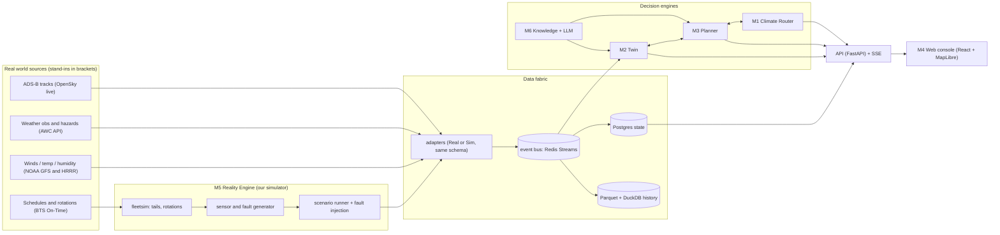
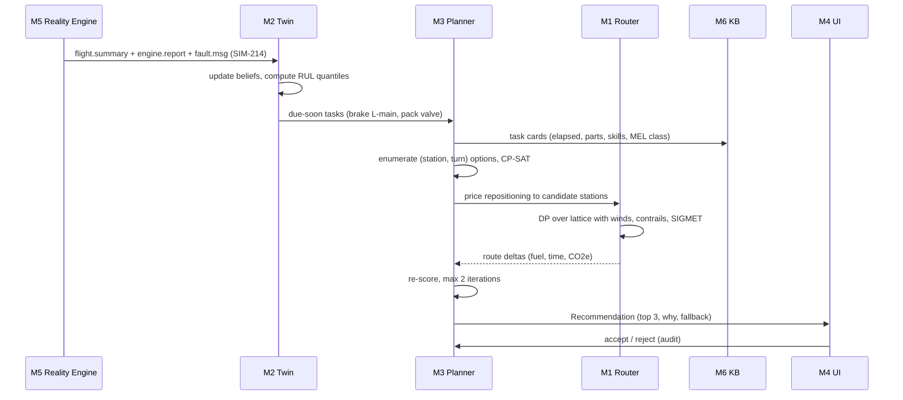

# HACKATLANTA: Project Meridian

> **Working name:** Meridian (rename in one minute, nothing depends on it).
> **One line:** one decision loop for an airline's two biggest controllable costs, what a flight
> puts into the sky and what a plane puts on the maintenance bill, with each side aware of the other.
>
> | | |
> |---|---|
> | **Owner** | Shamit Basu |
> | **Written** | 2026-10-09 (Fri) by Shamit's Claude from his research; update as facts get confirmed |
> | **Status** | PLAN ONLY when written. The event may already be underway: confirm the rules (§9, R-02), then follow §11 compressed to the time left |
> | **Copy** | Shared with teammates 2026-10-10. Server-specific details removed from the original |

---

## 0. Read this first (60 seconds)

**I could not find an event called "HackAtlanta."** The only match is **Hacklanta '26**. Everything
below assumes that is your event. Please confirm.

| Assumed fact (from a third-party event listing; **not** the official site) | Why it matters |
|---|---|
| Georgia State University, Student Center East Ballroom, **Oct 9 to 11, 2026**, 36 hours, in person | The clock may already be about to start |
| Kickoff **Fri Oct 9, 7:00 PM ET**; wrap-up and submissions **Sun Oct 11, 9:00 AM ET** | Plan in §11 is built on this |
| Teams of **up to 4**; 4 main tracks plus sponsor challenges (names not found) | Pick the track this fits; roles in §11 assume 4 people |
| Free; you must **also** apply at **hacklanta.dev**, not only on Devpost, or you are not eligible to submit or win | **Check this tonight** |
| The listing said "42 days to go", which is wrong for today's date, so the page is stale | Treat all of this as unverified |

**Five things to settle before or at kickoff** (also in §15):

1. Is this the right event, and are you registered at hacklanta.dev **and** Devpost?
2. Do the rules allow pre-written code, open-source libraries, and AI-assisted coding? (Many hackathons
   require that code be written during the event and ask you to disclose AI help. **That is why I wrote
   no code, only this plan.**)
3. Which track or sponsor challenge are we entering? If an aviation or airline sponsor is on site
   (Delta TechOps is based at ATL), talk to them in the first two hours.
4. Who are the (up to) 4 people, and who owns which module (§11.3)?
5. Which LLM API key will we use? (Share it privately; never in chat, issues or the repo, see §13.)

---

## 1. The pitch

### 1.1 Problem

Airlines make two large, repeating decisions largely in separate tools:

- **How to fly a flight.** Flight planning optimizes fuel and time. Climate impact is more than fuel:
  contrails, NOx and other non-CO2 effects are a large share of aviation's warming, but they are
  mostly not in the planning cost function.
- **When and where to fix an aircraft.** Maintenance control juggles intervals, deferred defects (MEL),
  hangar slots, parts and ground time. Predictive-maintenance products flag parts that are wearing,
  but deciding *which stop on this airplane's real itinerary is the cheapest place to act* is still
  largely manual.

### 1.2 Insight (our real differentiator)

The two decisions **change each other**, and nobody (publicly) closes the loop:

- **Maintenance changes the route.** The best station to do a brake or valve job has the part, the labor,
  a hangar slot and a long enough ground time. Going there changes the flight and its climate cost.
- **The route changes the wear.** Hot-and-high departures, thrust derate, runway length, dust and salt
  air, landing weight and taxi time all change how fast components age.

So Meridian treats an **aircraft as a live object (a digital twin)** and the **flight plan as a
proposal both sides score.** The novelty is the *coupling and the single operations picture*, not any one
model. We must say that plainly, because each individual piece has serious incumbents (§2).

### 1.3 What we build (the three asks, plus the platform)

| # | Module | Plain English |
|---|---|---|
| M1 | **Climate Router** | Route and altitude optimizer that prices CO2, contrails and NOx, not just fuel. Shows the trade-off curve. |
| M2 | **Aircraft Twin** | Each tail is an object of systems and components that wear based on how it is flown. Sensors update its state. Predicts remaining life. |
| M3 | **Maintenance Planner** | Takes the twin's predicted due dates plus the aircraft's actual flight plan and stops, and picks the best place and time to do the work with the least wasted time. |
| M4 | **Ops Platform** | One console: live flights, weather, aircraft condition, route options, maintenance board, what-if, emissions report. API first. |
| M5 | **Reality Engine** | The simulator and data fabric that makes realistic, imperfect data arrive the way it would in an airline. |
| M6 | **Knowledge layer** | LLM reads maintenance documents into structured, human-approved task cards and answers questions with citations. It never does the math. |

### 1.4 Honest competitive picture (judges will know this)

- **Contrail avoidance is real and already piloted.** A 2026 randomized trial (Google Research,
  American Airlines, Contrails.org, Flightkeys, Imperial) reported large contrail reductions for flights
  that flew the avoidance plan, but only about 9% of offered flights flew it. **Uptake, not physics, is
  the bottleneck**, so our UX must make a recommendation easy to accept (dollars, minutes, one click).
- **Contrail-only optimization is not automatically a net win.** A 2026 TU Delft/DLR preprint found most
  contrail-optimized flights emitted more NOx. We include NOx on purpose and show the metric used.
- **Predictive maintenance is crowded** (Airbus Skywise is used by Delta for part of its fleet; Boeing,
  GE, Honeywell and Lufthansa Technik all sell products). Our angle is *action planning across the
  itinerary and tying it to routing*, not "we also predict failures."

---

## 2. Landscape (what exists, and the gap)

| Area | Known work / incumbents | Gap we aim at |
|---|---|---|
| Climate-aware routing | Google Research + AA + Flightkeys trial; Flightkeys 5D; DLR / TU Delft aCCF research; `pycontrails` (Apache-2.0) | Mostly contrail-centric; not coupled to maintenance; uptake is low |
| Predictive maintenance | Airbus Skywise, Boeing AnalytiX, GE, Honeywell Forge, Lufthansa Technik AVIATAR | Fleet analytics and alerts; weaker on "which stop, which night, which hangar, given this itinerary" |
| Digital twins | Delta + Georgia Tech ASDL twin of the ATL hub (airport operations and fuel burn) | Airport-level, not tail-level wear |
| Open models and data | OpenAP (LGPL-3.0), ICAO engine emissions databank, NASA C-MAPSS / N-CMAPSS, NOAA GFS/HRRR, AWC, OpenSky | Everything we need to prototype exists and is public |

---

## 3. Product definition

### 3.1 Users and the job each one hires us for

| Persona | Job | Where they live in the product |
|---|---|---|
| **Dispatcher / OCC** | "Give me a route I can defend: cost, time, weather risk, climate." | Route options + Pareto slider + one-click accept |
| **Maintenance control (MCC)** | "Which tails need what, by when, and where do I do it without wasting ground time?" | Maintenance board + planner recommendations + what-if |
| **Line mechanic (station)** | "What do I do on this aircraft tonight, what parts, what manual reference?" | Mobile task view + cited Q&A |
| **Pilot / EFB** (read-only) | "What changed on my route and aircraft status?" | Briefing card (stretch) |
| **Sustainability analyst** | "Per-flight and fleet emissions with the method stated." | Emissions report |
| **Judge** | "What is new, does it work, can I trust the numbers?" | The demo, §11.6 |

### 3.2 Principles (these decide arguments later)

1. **Advisory only.** We recommend; humans decide. No auto-actuation anywhere.
2. **Monotone safety rule.** The system may recommend doing maintenance **earlier** than an approved
   interval, **never later**. Anything needing a limit extension becomes an "engineering query" for a
   human, never an automatic result.
3. **LLMs read and explain; deterministic code decides.** Limits and intervals come only from
   human-approved knowledge-base entries. If there is no source, the answer is "I don't know."
4. **Every recommendation is auditable** (inputs, model versions, parameters, who accepted).
5. **Simulated is always labeled SIMULATED**, in the UI, the API and the video.
6. **One thin vertical slice beats ten half-built features.**

---

## 4. Architecture

### 4.1 System view



### 4.2 Stack and what we rejected

| Concern | Choice | Rejected, and why |
|---|---|---|
| Backend | **Python 3.13**, FastAPI, pydantic v2, NumPy/SciPy. Modular monolith plus 2 worker processes | Microservice per module (36 hours; network glue eats the time) |
| Bus | **Redis Streams** (or in-process asyncio queue with the same interface) | Kafka (huge ops cost, zero demo benefit) |
| State | **Postgres 16** | Timescale/Neo4j (extra ops, no benefit at this scale) |
| History / weather cache | **Parquet + DuckDB** | A time-series DB |
| Fuel and emissions | **OpenAP** (LGPL-3.0 on PyPI, Python >= 3.11) | **BADA** (EUROCONTROL license, per-project, not redistributable) |
| Contrails | **pycontrails** (Apache-2.0, Python >= 3.12), CoCiP | Writing our own contrail physics |
| Optimization | NumPy DP for the router; **OR-Tools CP-SAT** (Apache-2.0) for the planner | A custom solver; a commercial solver |
| ML | scikit-learn / gradient boosting / small PyTorch on CPU | Anything needing a GPU (none here) |
| Frontend | **Vite + React + TypeScript**, MapLibre GL, deck.gl, ECharts | Next.js SSR (not needed), heavy blur/glow over maps (a known frame-rate killer, especially on software-rendered or low-end GPUs) |
| LLM | Claude API with structured outputs and citations | Letting the LLM produce numbers |
| Deploy | `docker compose` on the demo laptop; a second machine or cloud VM as a mirror | A Kubernetes cluster (overkill, extra risk) |

### 4.3 Repo layout (to be created at kickoff, not before)

```
meridian/
  contracts/        JSON Schemas + OpenAPI. The source of truth. Frozen first (§7.1)
  sim/              fleetsim, sensorgen, scenarios/*.yaml, faults.py
  fabric/           adapters/ (real/, sim/), bus.py, envelope.py, replay.py
  twin/             components/*.py, estimator.py, rul.py, params.yaml (with provenance)
  router/           grid.py, cost_fuel.py, cost_climate.py, dp.py, pareto.py
  planner/          model.py (CP-SAT), stations.yaml, explain.py
  knowledge/        smm/ (synthetic maintenance manual), extract.py, kb.sqlite, qa.py
  api/              FastAPI app, SSE, auth stub
  web/              React console
  eval/             harness, baselines, reports/
  infra/            docker-compose.yml, Makefile, seeds
  docs/             README, ARCHITECTURE, DATA-SOURCES, MODEL-CARDS, DEMO-SCRIPT
```

### 4.4 Dev ports (suggested; use anything free)

| Port | Use |
|---|---|
| 8230 | API |
| 8231 | Web console |
| 8232 | Sim control / scenario UI |
| 8233 | Contract mock server |
| 127.0.0.1:5433 | Postgres (never exposed) |
| 127.0.0.1:6380 | Redis (never exposed) |

---

## 5. Data: what is real, what is simulated, how it would truly arrive

This is the heart of "how we simulate data in and how it would actually come."

### 5.1 Reality versus stand-in (every feed)

| Data | How it **really** arrives at an airline | Real cadence / latency | **Our stand-in** | Honest limit |
|---|---|---|---|---|
| Aircraft position | ADS-B 1090ES broadcast, collected by receiver networks or vendor feeds | ~1 Hz, seconds | **Real:** OpenSky REST (OAuth2), recorded and replayable | No fuel, engine or tail data in ADS-B; ICAO24 must be mapped to a registration |
| Schedule and rotations | IATA SSIM / OAG / airline schedule DB | Daily with updates | **Real:** BTS On-Time (has tail numbers) for rotation shapes, or synthetic | We **rename tails** to fictional ones (§9, D-05) |
| Flight plan (OFP) | Flight-planning system (Jeppesen, Lido, Sabre, Flightkeys, in-house) to OCC | Per flight, hours ahead | Generated by our own baseline planner | Not a certified OFP |
| Ops events (OOOI: out, off, on, in) | ACARS over ARINC / SITA datalink, or ACARS-over-IP | Seconds to minutes | Simulated from schedule plus a delay model | |
| Engine and system reports | ACARS engine reports (takeoff, cruise snapshots), vendor cloud | Per flight phase | **Sensor generator** from the twin's hidden true state | Synthetic; ground truth known (good for scoring, circular if misused, §10) |
| High-rate flight data | QAR / FDR parameters (ARINC 717 / 429 decoded) **offloaded at the gate** (wireless / cellular), then FOQA / FDM tooling | **Batch per flight, hours later**; hundreds to thousands of parameters at 1 to 8 Hz | Per-leg **feature summaries** plus a few short time-series snippets | We do not simulate full-rate data |
| Fault and health messages | Aircraft maintenance computer post-flight reports and in-flight ACARS fault messages, ATA-coded | Seconds (in flight) or per flight | Fault generator keyed to component state | Codes are fictional |
| Maintenance records | MRO / M&E system (AMOS, TRAX, Ramco, Swiss-AS...) via DB, API or file export | Continuous, batch exports | Synthetic work orders and a **Synthetic Maintenance Manual** (§6.4) | Proprietary manuals are off limits (§9, D-01) |
| Parts and inventory | ERP / pool provider | Hourly to daily | Synthetic station inventory table | |
| Station capability | Part 145 ratings, hangar slots, shift rosters | Weekly | Synthetic table keyed to **real airport codes** with invented capabilities, labeled fictional | |
| Weather observations | METAR / SPECI, TAF, PIREP from FAA / NWS (AWC) | Minutes; TAF every few hours | **Real** AWC Data API, no key, <= 100 req/min, send a User-Agent; recorded for replay | PIREP call needs correct parameters (my guess returned 400) |
| Weather hazards | SIGMET, G-AIRMET, CWA | Minutes | **Real** AWC, plus a **synthetic storm injector** for the demo | |
| Winds / temperature / humidity aloft | WAFS gridded GRIB2 for dispatch; NWP models (GFS 0.25 deg, HRRR 3 km hourly for CONUS); ERA5 reanalysis | Model cycles (hours) | **NOAA GFS / HRRR** from the public S3 buckets (no auth, reachable from a home network) | NWP humidity is biased dry in ice-supersaturated regions (§6.1) |
| Turbulence | EDR downlinks, GTG model | Minutes | Skipped, or synthetic (stretch) | |
| NOTAMs | FAA NOTAM system | Continuous | A few hand-written ones for the demo | |
| Fuel price, fees | Contracts | Daily | Constants table (fictional) | |
| Emission factors | ICAO / CORSIA (3.16 kg CO2 per kg jet fuel); ICAO engine emissions databank | Static | Real, public | Databank covers the landing-takeoff cycle only; cruise NOx needs a method (§6.1) |
| Regulatory | Airworthiness directives (FAA DRS), service bulletins, MMEL | Continuous | A handful of fictional ADs / SBs | DRS has no public API that I found |

### 5.2 If it were real: scale, so we design for the right problem

Back-of-envelope (an estimate, not a measurement): 1,000 parameters x 4 samples/s x 3 h = about 43
million values per flight, about 170 MB. An airline flying 4,000 legs a day is roughly **0.7 TB/day of raw
QAR**. Conclusions for the architecture and the pitch:

- Real systems **extract features at the edge / gate** and ship summaries. So do we.
- Our hackathon scale (about 40 tails, about 200 legs a day) is trivial. **Modeling correctness, not
  throughput, is the hard part.** Do not spend hours on distributed systems.

### 5.3 Real path versus our path (adapter swap points)

```
REAL    Aircraft -> ACARS/SATCOM/gate offload -> vendor clouds + airline data lake -> [ADAPTER] -> envelope -> bus
OURS    fleetsim + sensorgen + (OpenSky, AWC, GFS replay) -------------------------> [ADAPTER] -> envelope -> bus
                                                                                                  ^
                                                       identical schema; only the adapter changes
```

An **adapter** implements `Source.poll() -> Iterator[Envelope]` and a `to_canonical()` mapper. The twin,
planner, router and UI never know whether data is real or simulated. This is the sentence for the pitch:
"swap the adapter, keep the platform."

### 5.4 Canonical envelope and entities

Every message is wrapped the same way (`contracts/envelope.schema.json`):

```json
{
  "id": "01JABC...",
  "type": "engine.report.v1",
  "tail": "SIM-214",
  "ts_event": "2026-10-10T14:03:22Z",
  "ts_ingest": "2026-10-10T14:03:25Z",
  "source": "sim.sensorgen",
  "synthetic": true,
  "schema_version": 1,
  "payload": { "...": "..." }
}
```

Conventions (violating any of these is a bug):

- **UTC ISO-8601 with `Z`** everywhere. Local time only at the UI edge.
- **SI units internally** (m, m/s, kg, K, Pa). Flight levels are integers (pressure altitude in 100s of
  feet) because airspace rules use them. Convert to ft / kt / lb **only at the UI edge**.
- **WGS-84** lat/lon. Great-circle math on the right model.
- `synthetic: true/false` on every event. Fictional tails look like `SIM-xxx`.
- `ts_event` (when it happened) and `ts_ingest` (when we saw it) are separate. We handle late data.

Core entities: `Aircraft`, `System`, `Component`, `Flight`, `Leg`, `Station`, `Task`, `Defect`,
`Part`, `WeatherCell`, `ClimateField`, `RouteOption`, `Recommendation`, `AuditEvent`.

Event types (bus topics): `adsb.state`, `ops.oooi`, `engine.report`, `flight.summary`, `fault.msg`,
`wx.metar`, `wx.hazard`, `nwp.cycle`, `twin.state`, `planner.rec`, `router.option`, `audit`.

### 5.5 The Reality Engine (M5) design

**Clock.** A sim clock with speed x1, x60, x600, plus pause and jump. Every component reads the clock,
never `now()`. Needed so a demo can show "a week of wear in 90 seconds."

**Determinism.** One master seed per scenario. Same seed, same world. The demo is reproducible and bugs
are reproducible.

**Fleet.** About 12 to 40 fictional tails across 2 to 3 generic types (a narrowbody twin such as A320 /
B738 class, plus optionally a widebody). **Check OpenAP's supported types at hour 0 and match.** Each tail
has hidden **true component state** that evolves by the twin's wear laws, plus per-tail "personality"
(some wear faster) so there is something to find.

**Schedule.** Rotations built from BTS On-Time shapes (real tail routings, renamed) or synthetic
hub-and-spoke through ATL. 7 to 30 simulated days.

**Sensor generator.** From the true state, emit noisy observations: EGT margin, vibration, oil
pressure / temperature, brake wear pin and temperature, tire pressure, hydraulic pressure and
temperature, duct temperatures, cycle counts. Noise, bias and quantization are configurable.

**Fault generator.** Turns state thresholds and random events into ATA-coded fault messages with
realistic cascades (one root cause, several symptoms).

**Fault injection (data is dirty in real life).** A switchable catalog, each with an expected platform
behavior:

| Fault | Example | Expected behavior |
|---|---|---|
| Dropped / duplicated / out-of-order messages | duplicate ACARS report | Idempotent processing by `id`; no double counting |
| Late data | QAR summary arrives 6 h after landing | State is recomputed, recommendations revised, audit shows why |
| Clock skew | event timestamp +/- N seconds or minutes | Flag, use `ts_ingest` bounds |
| **Unit swap** | lb vs kg, ft vs m | Reject at the boundary with a validation error. (Real-world precedent: the 1983 Gimli Glider fuel-load error was lb vs kg.) |
| Stuck / spiking / drifting sensor | flatline EGT | Mark sensor suspect; widen uncertainty; do not trust blindly |
| Registration change / ICAO24 reuse | tail to hex mapping changes | Lookup table with validity periods |
| Schema version bump | `engine.report.v2` | Versioned handler; unknown versions quarantined, not crashed on |
| Partial payload | missing fields | Degrade gracefully, show reduced confidence |
| Feed outage | AWC unreachable | Use cache; banner "weather stale by N min" |

**Scenarios** are YAML files: seed, fleet, schedule window, scheduled events ("convective SIGMET over DFW at
T+3h", "tail 214 left-main brake wear accelerates", "ATL overnight hangar full", "OpenSky down"). A
`golden` scenario backs the demo; a `chaos` scenario turns many injections on for a robustness proof.

**Recorder (optional, ask first).** A small always-on job on a spare machine that records AWC METAR / SIGMET /
G-AIRMET and OpenSky CONUS states to Parquet gives us **real replayable data for baselines.** Constraints:
OpenSky credits are per endpoint family (anonymous 400/day, registered 4,000/day, a global `/states/all`
costs 4), so use a registered client (credentials shared privately). It is code, so only start it once the rules say
that is allowed (§0 item 2). I did **not** start it.

### 5.6 Where real data genuinely appears in the demo

So the story is "real data, simulated airline":

- Live ADS-B around ATL on the map (OpenSky).
- Live METAR / SIGMET / G-AIRMET overlays (AWC).
- Real winds and humidity aloft (GFS/HRRR) driving the router.
- Real airport coordinates and real route geometry.
- C-MAPSS / N-CMAPSS engine degradation data for the engine RUL model (verify license and availability;
  NASA's catalog page was reported unavailable while mirrors exist).

Everything about **tail health and the maintenance system is simulated and labeled so.**

---

## 6. Module designs

### 6.1 M1 Climate Router

**Goal.** For a city pair, aircraft type, weight and departure time, produce route and altitude options on
a **trade-off curve** (fuel, time, CO2-equivalent), with weather hazards avoided.

**Cost function** for a candidate path P:

```
J(P) = c_fuel * Fuel(P)  +  c_time * Time(P)  +  c_clim * CO2e(P)  +  c_risk * Risk(P)
CO2e(P) = 3.16 * Fuel(P)            # kg CO2 per kg jet fuel (ICAO / CORSIA factor)
        + NOx_term(P)               # altitude / latitude / season dependent
        + Contrail_term(P)          # only where persistent contrails are predicted
        (+ H2O, soot: small, optional)
```

`c_clim` is exposed as a **carbon price slider ($ per tonne CO2e)** so the Pareto curve becomes a single
control a dispatcher understands. (For scale, the reported cost of contrail avoidance in the pilot was on
the order of $5 to $25 per tonne CO2e; read the paper before quoting.)

**Fuel and emissions.** OpenAP fuel flow and drag with a mass that decreases along the path. Because mass
depends on fuel burned so far, plain DP is approximate. Do a **two-pass refine**: solve with an estimated
mass profile, recompute mass along the found path, solve again.

**Contrails (the main climate lever).** A contrail forms if the Schmidt-Appleman criterion is met and
**persists** if the air is ice-supersaturated (relative humidity over ice >= 100%).

- Fast layer (demo): compute a **contrail cost field** on the (lat, lon, FL, hour) grid from GFS/HRRR
  temperature and humidity, with a documented humidity bias correction. **Time of day matters:** contrails
  at night warm; some daytime contrails can cool. So the field depends on local solar time.
- Slow layer (evaluation): run `pycontrails` **CoCiP** on the candidate and baseline paths to score the
  Pareto set. Precompute on a laptop for demo routes; do not run live on a small server.

**NOx.** ICAO's databank gives landing-takeoff-cycle data only. Cruise NOx needs a method such as scaling
with the Boeing Fuel Flow Method 2 using databank values. OpenAP also has emission functions (verify).
Climate sensitivity of NOx varies with altitude, latitude and season; DLR's algorithmic climate change
functions (aCCF; verify the open-source package and license) can supply that. Fallback: a documented
lookup table.

**Metric honesty.** CO2-equivalent for contrails depends heavily on metric and horizon (GWP100, GWP20,
ATR). Headline GWP100, and **show a sensitivity band** for ATR20. State the metric on every chart.

**Algorithm (hackathon grade).**

1. Build a **corridor lattice** around the great circle: columns every ~50 NM along track (~20 to 60),
   lateral offsets +/-200 NM in ~10 NM steps (~21+ points), vertical levels as a handful of flight
   levels.
2. Progress along track is monotone, so the graph is a **DAG**: label-setting DP is O(columns x
   states^2) and vectorizes in NumPy. Precompute fuel flow as a lookup over (mass, Mach, altitude).
3. **Hard constraints:** avoid convective SIGMET polygons with a buffer; follow the **semicircular /
   RVSM flight level rule** (eastbound odd levels, westbound even, verify against the rule text); stay
   within aircraft ceiling for weight; respect reserve fuel; avoid prohibited / restricted airspace; keep
   within a corridor so ATC would plausibly accept it.
4. Sweep `c_clim` over ~10 to 20 values to trace the **Pareto front**; mark the knee.
5. Output `RouteOption` objects (path, per-leg metrics, hazards avoided, contrail km avoided, deltas vs
   baseline, assumptions used).

**Baselines to beat or at least match honestly:** min-time, min-fuel, great circle at a standard level, and
a **recorded real track** from our own OpenSky recording.

**Stretch: wear-aware routing.** Add a small term for engine wear from the chosen altitude / thrust
profile (links M1 to M2).

**What it will not do:** model real ATC flow restrictions, real airway structure in detail, or
oceanic procedures. Say so.

### 6.2 M2 Aircraft Twin

**Object model.** `Aircraft(tail)` has `System`s (powerplant, landing gear and brakes, hydraulics, air
conditioning and pneumatics, airframe structure, APU...) which have `Component`s. Each component has
a **state vector**, a **wear law**, an **observation model**, and a **remaining-life estimate with an
uncertainty distribution.**

```python
class Component(Protocol):
    def step(self, state, usage: UsageEvent, env: Environment, dt) -> State: ...   # physics-ish wear
    def observe(self, state, rng) -> Observation: ...                              # what sensors would show
    def update(self, belief, obs) -> Belief: ...                                   # Bayesian / Kalman update
    def rul(self, belief, quantile: float) -> RUL: ...                             # in FH, FC and days
```

`UsageEvent` is what a flight does to the aircraft: takeoff thrust / derate, OAT vs ISA, field
elevation, landing mass and speed, autobrake setting, runway length and condition, taxi time, crosswind,
dust / salt exposure at the airport, pressurization cycle (delta P), flight duration.

**Demo components and laws (all constants live in `twin/params.yaml` and each is tagged `assumed`, `cited`
or `fitted`; the UI shows `assumed` honestly).**

| Component | State | Main drivers | Demo wear law | Observable |
|---|---|---|---|---|
| **Engine** | EGT margin (K), HPC efficiency loss | Takeoff thrust / derate, hot day, high field, dust / salt, cycles | Margin decays per cycle, scaled by drivers; RUL from a model trained on **C-MAPSS / N-CMAPSS** plus a Kalman filter on the margin trend | EGT margin, N1 / N2 vibration, fuel flow |
| **Brakes** | Wear pin length, temperature | Landing mass and speed, autobrake, runway length, taxi count | Wear proportional to absorbed kinetic energy | Wear pin, brake temp |
| **Tires** | Tread depth | Landings, crosswind, taxi distance | Per-landing wear with random scrub factor | Pressure, tread |
| **Hydraulic pump** | Efficiency, case-drain flow | Hours, fluid temperature, pressure cycles | Weibull hazard with Arrhenius temperature acceleration | Case-drain temp / flow, pressure |
| **Pack / bleed valve** | Stiction index | Hot-day cycles, humidity | Weibull with thermal-cycle acceleration | Duct temp deviation, fault messages |
| **Airframe pressurization fatigue** | Damage index D | Pressurization cycles, delta P | Miner's rule: D = sum(n_i / N_i), assumed S-N parameters | Cycle count |

(Stretch: APU, flight-control actuators, landing gear actuators.)

**Estimator.** Per component, keep a **belief** (mean and covariance, or particles for non-Gaussian). Each
observation updates it. Output **quantiles**: P10 / P50 / P90 RUL. The planner uses a **conservative
quantile** (default P10) so we err toward earlier action (monotone safety rule).

**Health score** (UI): a function of RUL relative to the maintenance interval, with the reason shown
("brake pin 3.1 mm above limit, P10 = 14 flight cycles").

**Validation story (important):** wear constants cannot be validated without proprietary data. So we
validate the **method** on external data (C-MAPSS RUL error), show **sensitivity of recommendations to
assumed parameters**, and say an airline would calibrate with its own data. Never claim our constants are
real.

### 6.3 M3 Maintenance Planner ("the next best place to stop")

**Inputs.**

- Twin: for each open task, a **due deadline** in flight hours, flight cycles and calendar, taken at the
  conservative quantile. Plus defects already open.
- **Deferred defects (MEL).** Typical repair-interval categories on a master minimum equipment list:
  A (as stated in the item), B (3 consecutive calendar days), C (10 days), D (120 days). **Verify against the
  MMEL for the type**; do not hard-code as fact.
- The aircraft's **actual itinerary:** the next N days of legs and ground times (from M5).
- **Station table:** hangar availability, Part 145 capability, parts in stock and lead times, shift
  windows, labor cost, weather-closure risk.
- Task cards from the knowledge base (§6.4): elapsed time, man-hours, parts, required skill, whether it
  can bundle with other tasks (shared access / setup).

**Decision.** For each task, choose *(station, turn)* between legs, optionally inserting a
**positioning** change (route via a maintenance base) priced by M1.

**Objective** (all in dollars or equivalent, weights editable):

```
minimize  disruption_minutes  * c_disrupt          # ground time beyond the planned turn, plus delays
        + positioning_cost                          # extra flying, priced by M1 incl. CO2e
        + parts_shipping + outstation_labor_premium
        + c_waste * (unused life fraction)          # doing it too early throws away life
        + c_risk  * P(exceed limit)                 # doing it too late
        - bundling_savings
subject to  done before conservative deadline  (hard)
            fits in ground time (+ costed extension)
            parts present or arrive in time
            hangar slot, skills, station open
```

Solve with **CP-SAT**. Rotations of <= 7 days with a handful of open tasks is a small model.

**"Non-time-wasting" is defined, not hand-waved:** minimize *non-productive aircraft minutes* =
`max(0, maintenance elapsed - scheduled turn) + positioning minutes`.

**Outputs.** Top 3 *(station, time)* options with cost breakdown, margin to deadline, a fallback if the
primary fails ("if the part is late, here is plan B"), and a **plain-language why**. Every output is a
`Recommendation` record:

```json
{
  "id": "rec_...", "tail": "SIM-214", "created": "...Z", "synthetic": true,
  "action": "replace left-main brake assembly",
  "where": "ATL", "when": "overnight 2026-10-11",
  "margin_to_deadline": {"cycles": 9, "quantile": "P10"},
  "cost": {"disruption_min": 0, "positioning_cost": 0, "co2e_kg": 0, "parts": 0},
  "alternatives": ["DFW (no part, +95 min)", "LAX (hangar full)"],
  "evidence": ["twin:brake.l_main@v12", "kb:task 32-40-01@approved"],
  "model_versions": {"twin": "0.3", "planner": "0.2", "params": "sha:..."},
  "status": "proposed"
}
```

**Human in the loop.** `proposed -> accepted | rejected(reason)`; acceptance is an audit event.

**What it will not do:** real parts logistics, union / labor rules, regulatory sign-off, or deciding to
extend a limit.

### 6.4 M6 Knowledge layer ("using the manuals")

**The legal reality:** Boeing and Airbus maintenance manuals (AMM, MPD, IPC, SRM...) and airline
manuals are **licensed, copyrighted and customer-specific.** We cannot ingest them for a hackathon.

**So we build a Synthetic Maintenance Manual (SMM):** a small set of documents we author in the standard
structure (ATA chapters like 32 landing gear, 36 pneumatics, 72 engine; task cards with interval,
limits, elapsed time, man-hours, parts, skills, MEL category). Pair it with **public** sources for
realism: FAA handbooks and advisory circulars, FAA Service Difficulty Reports (yearly CSV; the FAA page
returned 403 to scripts from a home network, so download by hand in a browser), NTSB database, public ADs.

**Pipeline:**

1. LLM **proposes** structured task cards from document text (JSON schema enforced).
2. A human **approves** each in a review screen. Only approved items are in the KB.
3. The twin and planner read **only the approved KB**, with versions.
4. Q&A for mechanics: retrieval over the approved KB plus public docs, **citations required,**
   "I don't know" when unsupported.
5. Guardrail: any number the LLM states must equal an approved KB value, or it is rejected in code.

This demonstrates exactly how a real customer would plug in *their own* licensed manuals, on their own
infrastructure, and it keeps us legal.

**Demo reliability:** cache LLM outputs for the golden scenario so the demo works with no network.

### 6.5 M4 Ops Platform, API and UI

**API first.** FastAPI + OpenAPI; SSE for live updates (WebSocket only if needed). Selected endpoints:

| Endpoint | Purpose |
|---|---|
| `GET /fleet`, `GET /aircraft/{tail}` | Fleet list; one tail with twin state |
| `GET /aircraft/{tail}/components` | Component beliefs and RUL quantiles |
| `GET /flights`, `GET /flights/{id}` | Flights, including live tracks |
| `POST /route/optimize` | Returns `RouteOption[]` for a Pareto sweep |
| `GET /maintenance/board` | Tasks vs deadlines vs planned stops |
| `POST /planner/recommend`, `POST /planner/whatif` | Recommendations; "hangar X closes" |
| `POST /recommendations/{id}/decision` | Accept / reject (audited) |
| `GET /weather/{layer}` | Tiles / GeoJSON for METAR, SIGMET, G-AIRMET, contrail risk |
| `GET /emissions/report` | Per-flight and fleet CO2e with method stated |
| `GET /sim/status`, `POST /sim/scenario`, `POST /sim/faults` | Reality Engine control |
| `GET /data-health` | Feed freshness, quarantine counts |
| `GET /stream` | SSE event feed |

**Screens.**

1. **Ops map:** fleet, live ADS-B, METAR / SIGMET / G-AIRMET, contrail-risk layer.
2. **Flight detail + Route Lab:** carbon-price slider, Pareto chart, side-by-side routes, deltas in
   dollars / minutes / CO2e.
3. **Aircraft twin:** schematic (2D SVG is enough) with components colored by health; click for RUL and
   evidence.
4. **Maintenance board:** Gantt of tasks vs deadlines vs the aircraft's stops; recommendation cards.
5. **What-if:** drag a closure or delay in, watch the plan recompute.
6. **Data health:** feeds, latency, quarantined messages, fault-injection toggles.
7. **Emissions report.**
8. **Mechanic mobile view:** tonight's tasks, parts, cited Q&A.

**UI rules.** SIMULATED badge always visible. Show units (and a toggle for metric/imperial).
**Performance:** avoid backdrop blur and heavy glow on persistent elements over the map (these tanked
frame rate on WebGL pages); keep deck.gl layers few and simplified. Any 3D aircraft model must be
CC0 or built procedurally (§9, D-08).

---

## 7. Integration: how every part fits

### 7.1 Contracts first (the thing that lets 4 people work in parallel)

By **T+3h** freeze `contracts/` v1: JSON Schemas for envelope and entities, OpenAPI for the API.
Generate types for Python (`datamodel-code-generator`) and TypeScript (`openapi-typescript`). Run a
**mock server** (port 8233) from the OpenAPI so the front end is never blocked. After the freeze, a
contract change needs a one-line note in `contracts/CHANGELOG.md` and a ping to the owners.

### 7.2 Ownership table

| Contract | Producer | Consumers |
|---|---|---|
| `Envelope`, `*.report`, `fault.msg` | M5 | M2, DB, UI |
| `twin.state`, RUL quantiles | M2 | M3, UI |
| `ClimateField` | M1 (grid builder) | M1 DP, UI layer |
| `RouteOption` | M1 | M3, UI |
| `Recommendation` | M3 | UI, audit |
| `KBItem` (approved) | M6 | M2, M3, Q&A |

### 7.3 The golden-path sequence



### 7.4 The coupling loop and when it stops

Planner proposes stations; Router prices the route to each; Planner re-scores; **at most 2 iterations**,
or stop when the top choice does not change. This bound keeps the demo deterministic and fast.

### 7.5 Degradation behavior (what happens when something is wrong)

| Failure | Behavior |
|---|---|
| Weather feed down | Use last cache, banner shows age, router widens hazard buffers |
| NWP cycle missing | Use previous cycle, mark confidence lower |
| Twin lacks recent sensor data | Widen RUL uncertainty (P10 gets earlier), flag "stale health" |
| Router infeasible | Return the least-bad option with the violated constraint named |
| LLM unavailable | Serve cached explanations; Q&A disabled with a message |
| Planner infeasible | Say which deadline cannot be met; escalate as "needs human" |

### 7.6 Time budget for integration

Integration is where hackathon projects die. Fixed checkpoints in §11.4. Rule: **end-to-end ugly beats
module-perfect.**

---

## 8. The field platform: what else we can add (tiered)

The idea is a platform pilots, dispatchers, mechanics and sustainability teams use. Each add-on reuses
the same data fabric and twin.

| Tier | Feature | Reuses | Notes |
|---|---|---|---|
| **T0 (demo)** | Ops map with live ADS-B and weather | AWC, OpenSky | Visual anchor |
| T0 | Route Lab, Maintenance board, Twin view | M1, M2, M3 | The demo |
| T1 | Cited maintenance Q&A and manual extraction | M6 | The "uses the manuals" proof |
| T1 | Fault-injection / data-health panel | M5 | Shows robustness and realism |
| T1 | Emissions report per flight | M1 | Method stated |
| T1 | Mechanic mobile view | API | Station users |
| T2 | Disruption recovery (tail swap, delay what-if) | M3 | Natural extension |
| T2 | Turbulence / convective avoidance as first-class | M1 | Needs EDR data |
| T2 | Parts pre-positioning forecast | M2, M3 | Predicts demand per station |
| T2 | Briefing generator for dispatchers (weather + NOTAM summary with sources) | M6 | LLM with citations |
| T2 | MCP / agent interface to the API | API | Cute, cut first |
| Roadmap only | Real integrations, certification path, global airspace, crew legality, passengers | | Slide, not code |

**Replacement map (honest).** The brief said "a major replacement for a lot of the tech in the
industry." What it can credibly *become*, module by module:

| Incumbent category | Examples | Where Meridian could eventually compete | Reality check |
|---|---|---|---|
| Flight planning | Jeppesen, Lido, Sabre, Flightkeys | M1 as a climate-aware planning layer | Certified, deeply embedded, ATC-integrated |
| Predictive maintenance | Skywise, AnalytiX, Forge, AVIATAR | M2 + M3 | Backed by OEM data we do not have |
| M&E / MRO software | AMOS, TRAX, Ramco, Swiss-AS | Not a replacement; integrate | Regulated records of truth |
| Weather services | DTN, The Weather Company | M4 weather fusion | Proprietary models and contracts |

Pitch it as **"the decision layer on top, interoperating first, replacing module by module only where it
earns it."** Claiming it replaces the industry stack invites a quick, fair takedown.

---

## 9. Things to avoid

Read before kickoff. IDs are used in reviews ("this violates D-04").

### 9.1 Rules, legal and IP

| ID | Don't | Why | Instead |
|---|---|---|---|
| **R-01** | Assume you are registered | The listing says the **hacklanta.dev** application is required in addition to Devpost, or you cannot submit or win | Confirm tonight |
| **R-02** | Write project code before kickoff | Many hackathons require code written during the event; unverified here | Plan, research and design only until the rules are read; this doc is the pre-work |
| **R-03** | Hide AI-assisted work | Many events require disclosure of AI help; a violation can disqualify | Read the AI policy; if allowed, disclose it in the README and Devpost |
| **R-04** | Reuse another project's code, or submit work from a prior project | Typical disqualification | Everything new; credit libraries |
| **D-01** | Ingest Boeing / Airbus / airline manuals (AMM, MPD, IPC, SRM) | Licensed and copyrighted, customer-specific | Synthetic Maintenance Manual plus public FAA / NTSB sources (§6.4) |
| **D-02** | Use **BADA** for fuel | EUROCONTROL license, per project, not redistributable | **OpenAP** |
| **D-03** | Scrape FlightAware, Flightradar24, ADS-B Exchange or similar | Terms of service forbid it; accounts and IPs get blocked | OpenSky (OAuth2), AWC, NOAA |
| **D-04** | Ignore OpenSky terms | Free for research / non-commercial; they can change policy and rate limits | Read current terms; credit-aware polling; say "non-commercial prototype" |
| **D-05** | Attach fake health data to **real** tail numbers or name a real airline's aircraft as faulty | Misleading and potentially defamatory; looks like real maintenance records | Rename tails (`SIM-xxx`); real rotations are fine, health is fictional |
| **D-06** | Use real airline logos or imply endorsement | Trademark, false affiliation | Neutral branding |
| **D-07** | Use real passenger, crew, or employee data | Privacy, nothing to gain | None needed |
| **D-08** | Download a "free" Boeing / Airbus 3D model | Licenses are often non-commercial or unclear | CC0 model with the license recorded, or a procedural low-poly plane |
| **D-09** | Treat dataset licenses as obvious | NASA's C-MAPSS catalog page was reported unavailable; mirrors exist | Record source, URL and license in `docs/DATA-SOURCES.md` |
| **D-10** | Assume an NOTAM / FAA SWIM / AD API exists and is open | SWIM needs registration; DRS had no public API that I found; FAA SDR page returned 403 to scripts | Manual downloads, tiny hand-curated sets |

### 9.2 Safety and regulatory claims

| ID | Don't | Why | Instead |
|---|---|---|---|
| **S-01** | Say it "decides airworthiness," replaces maintenance control, or is "FAA approved/certified" | False and dangerous. Part 121 carriers run an FAA-approved maintenance program with continuing analysis and surveillance; interval changes go through a reliability program (FAA AC 120-17B) | "Decision-support prototype; advisory; humans approve" |
| **S-02** | Let any logic extend an interval or MEL deferral | Violates the monotone safety rule | Earlier only; extensions become an engineering query |
| **S-03** | Present assumed wear constants as real | Cannot be validated without airline data | Tag `assumed`; show sensitivity; say "calibrate with airline data" |
| **S-04** | Let the LLM generate limits, torque values or intervals | Hallucinated numbers in aviation is the worst failure | Approved KB only; code check that numbers match |
| **S-05** | Route through convective cells, prohibited airspace, or ignore the semicircular / RVSM level rule | Output would be rejected by any dispatcher on sight | Hard constraints (§6.1) |
| **S-06** | Skip reserves, ceilings, or weight limits | Same | Encode them or say clearly which are out of scope |
| **S-07** | Imply real-time control of aircraft | Not a thing we do | Read-only advisory |

### 9.3 Science and modeling traps

| ID | Don't | Why | Instead |
|---|---|---|---|
| **M-01** | Optimize contrails only and call it "net climate win" | A 2026 TU Delft/DLR preprint found most contrail-optimized flights emitted more NOx | Include NOx; show the metric and a sensitivity band |
| **M-02** | Headline one "% reduction" without the metric | GWP100 vs GWP20 vs ATR change the answer a lot | State metric and horizon on every chart |
| **M-03** | Trust raw NWP humidity for contrails | Known dry bias in ice-supersaturated regions | Documented correction; call it an uncertainty, not a fact |
| **M-04** | Forget day/night | Night contrails warm, some daytime contrails cool | Time-of-day in the cost field |
| **M-05** | Claim ADS-B tells you fuel, engine health or tail | It does not | Say what each feed contains (§5.1) |
| **M-06** | Validate only on your own simulator | Circular: the model "discovers" what you built in | External data (C-MAPSS), sensitivity analysis, honest scope |
| **M-07** | Overfit to C-MAPSS | It is a simulator with specific fault modes | Report test-set error, say what it is |
| **M-08** | Mix units | Real accidents (Gimli Glider) | SI inside, convert at the edge, unit tests |
| **M-09** | Local times in the core | DST and zone bugs corrupt wear and schedules | UTC everywhere |
| **M-10** | Wind-vector sign convention errors | A classic way to look optimal by flying backwards | Test with a known synthetic wind field |
| **M-11** | Ignore cycle vs hour vs calendar limits | Components have all three | Track and enforce all three |
| **M-12** | Build deep nets you cannot explain | Judges, and aviation, want traceable reasons | Physics-ish laws plus small models; explain every output |

### 9.4 Engineering and process

| ID | Don't | Why | Instead |
|---|---|---|---|
| **E-01** | Over-architect (Kafka, K8s, a service per module) | 36 hours; the glue eats the time | Modular monolith, Redis Streams or in-proc bus |
| **E-03** | Depend on venue wifi or live APIs during the demo | They fail at the worst moment | Cache and replay everything; offline mode; video backup |
| **E-04** | Run heavy compute live during the demo | A loaded laptop or small server stalls; CoCiP-style jobs take minutes | Precompute ahead of time; serve cached results |
| **E-05** | Start features you will not finish | Half-built demos lose to one polished path | MUST / SHOULD / COULD tiers (§11.2) and a hard feature freeze |
| **E-06** | Change contracts silently | Breaks the other three people | Changelog plus ping |
| **E-07** | Commit secrets or API keys | Leaked keys in public repos are scraped within minutes | `.env` in `.gitignore`; keys shared privately; secret scan before every push |
| **E-08** | Paste keys into chat, issues or commits | They leak and are hard to revoke cleanly | Environment variables or a secrets manager |
| **E-09** | Hide how AI was used | Some events require disclosure | Follow the event's AI policy; say so in the README and Devpost |
| **E-10** | Skip a golden-path test | The demo is the product | `make demo-check` runs the golden scenario and asserts the key numbers |
| **E-11** | Let the whole team skip sleep | Sunday-morning demos fail on exhausted brains | Scheduled sleep shifts (§11.4) |

### 9.5 Pitch and credibility

| ID | Don't | Why | Instead |
|---|---|---|---|
| **P-01** | Say "we replace the airline industry's tech" | Easy to refute; see §8 | "Decision layer, interoperate first" |
| **P-02** | Quote savings you did not compute | Judges will ask how | Quote only numbers from the eval harness, with method |
| **P-03** | Claim novelty for each component | Incumbents exist | Claim the **coupling** and the **unified picture**, cite prior work |
| **P-04** | Show simulated data as if live | Trust killer | SIMULATED badge, said out loud |
| **P-05** | Put 10 features in 3 minutes | Judges remember one idea | One scenario, one story |
| **P-06** | Quote press numbers as facts | Several come from coverage, not the paper | Read the paper or cite as "reported" |

### 9.6 Security and exposure

| ID | Don't | Why | Instead |
|---|---|---|---|
| **X-01** | Expose dev servers or admin/sim-control endpoints on the venue network | Hackathon wifi is hostile | Bind to localhost; token on admin routes |
| **X-02** | Put a public URL on a machine with other things on it | Public-facing change | Deploy the demo separately, or use the laptop and the video |
| **X-03** | Write secrets into world-readable files or shared drives | Anyone on the machine/drive can read them | Mode 0600 files; `.env` untracked |

---

## 10. Evaluation and claims policy

Numbers on a slide must come from `eval/` and state their method.

| Module | Test | Metric | Baselines |
|---|---|---|---|
| M1 | Replay 10 to 20 CONUS city pairs on recorded or archived weather | Fuel delta %, time delta min, CO2e delta % (metric stated), contrail km avoided, constraint violations (must be 0) | Min-time, min-fuel, great circle, recorded real track |
| M2 engine | C-MAPSS / N-CMAPSS held-out engines | RMSE and NASA score on RUL; calibration of P10 / P90 | Mean-RUL baseline, simple regression |
| M2 fleet | Monte Carlo over 100+ seeds | Lead time between recommendation and limit; missed-deadline count; false-alarm rate | "Do it at the limit," "fixed interval" |
| M3 | Same Monte Carlo | Non-productive aircraft minutes; deadline breaches; cost | "Nearest base," "at the limit," "fixed A-check schedule" |
| M5 | Chaos scenario | No crash; every injected fault caught and classified | N/A |
| Platform | Load and latency | p95 API latency; time from event to recommendation | N/A |

**Circularity warning (M-06).** Fleet results on our own simulator show the *system works against its
assumptions.* We say so, and we back the engine model with external data.

---

## 11. Execution plan (36 hours)

Times are **ET and assumed**: T+0 = Fri 19:00; T+36 = Sun 07:00; wrap-up Sun 09:00. **Verify the actual
submission deadline** (it may be earlier than hacking ends).

### 11.1 Before kickoff (now to Fri 19:00). No code.

- [ ] Confirm the event, hacklanta.dev + Devpost registration, rules (pre-written code, AI policy, team
      size, submission format, video length) (§0).
- [ ] Decide track / sponsor challenge; find aviation-savvy mentors.
- [ ] Confirm roles (§11.3). Agree the working name.
- [ ] Get the LLM key and an OpenSky API client sorted (§13). OpenSky OAuth2 clients are made in the user's
      OpenSky account; share credentials privately.
- [ ] Read this doc end to end; mark scope cuts you disagree with.
- [ ] Charge laptops; plan a backup demo machine; bring a phone hotspot.

### 11.2 Scope tiers

| Tier | Contents | Cut rule |
|---|---|---|
| **MUST** (the demo) | Sim of >= 12 tails x 7 days; twin with >= 4 components; planner returning ranked stations with explanation; router with fuel-only vs CO2e Pareto on >= 3 city pairs; ops map with live weather; scenario runner; SIMULATED labels; end-to-end golden path | Never cut |
| **SHOULD** | Coupling loop; cited Q&A + manual extraction; fault injection and data-health panel; eval harness with real numbers; mechanic view | Cut from the bottom if behind at T+14 |
| **COULD** | Live ADS-B overlay polish; 3D twin; emissions report export; turbulence; disruption recovery | Cut first |
| **WON'T** | Real integrations, certification, global airspace | Roadmap slide only |

### 11.3 Roles (suggested, assuming 4)

| Role | Owns | Also |
|---|---|---|
| **A: Atmosphere and Route** | M1 (lattice, DP, fuel, contrails, NOx), weather ingest | Eval for M1 |
| **B: Twin and Planner** | M2, M3 (laws, estimator, CP-SAT) | Eval for M2, M3 |
| **C: Data fabric and Platform** | M5, bus, DB, API, infra, scenarios, backup mirror | Contracts, `make demo-check` |
| **D: Front end and Story** | M4 UI, M6 shell, demo, video, Devpost, deck | Rehearsals |

If fewer than 4 people: merge A+B (drop M6 first), or C+D (stub the API with the mock server).

### 11.4 Hour-by-hour

| T+ | Clock | Plan | Checkpoint |
|---|---|---|---|
| 0 to 3 | Fri 19:00 to 22:00 | Team, mentors, confirm scope; **freeze contracts v1**; scaffold repo; compose stack; mock server; pick demo scenario and 3 city pairs; pick aircraft types supported by OpenAP | **IC-1 (T+3):** contracts frozen, mock server up |
| 3 to 10 | Sat 22:00 to 05:00 | Parallel slices: sim v0 (schedule + fleet + sensors), twin v0 (3 components), router v0 (fuel-only DP), UI shell + map + weather. **Sleep shifts begin ~T+7** (two people at a time, 4 h) | **IC-2 (T+10):** sim to twin to UI shows a health change |
| 10 to 18 | Sat 05:00 to 13:00 | **First end-to-end slice:** sim to twin to planner to recommendation card; router climate cost (contrail field + NOx); planner CP-SAT v0 | **IC-3 (T+14):** E2E ugly. If not, cut SHOULD items now |
| 18 to 26 | Sat 13:00 to 21:00 | Coupling loop; what-if; fault injection; KB extraction and cited Q&A; eval harness producing numbers | **IC-4 (T+22):** all MUST done |
| 26 to 28 | Sat 21:00 to 23:00 | Final features; polish | **FEATURE FREEZE at T+28 (Sat 23:00)** |
| 28 to 33 | Sat 23:00 to Sun 04:00 | Hardening, `make demo-check`, README, Devpost write-up, record **backup video**, rehearse 3x, deck. Sleep shifts | **IC-5 (T+32):** demo rehearsed, video recorded |
| 33 to 36 | Sun 04:00 to 07:00 | Buffer, submit early, final checks on the backup machine | **Submit by T+34** unless rules say earlier |

### 11.5 Cut lines (decide in advance so panic does not decide)

- T+14, no end-to-end: drop M6 Q&A, fault-injection UI, mechanic view.
- T+22, MUST not done: freeze everything else; all hands on MUST.
- T+28: no new features. Only bugs, polish and story.

### 11.6 Demo script (3 minutes) and golden scenario

**Scenario `golden`:** fictional tail **SIM-214** (narrowbody twin) with a 2-day itinerary through ATL,
a western city, and back.

1. **0:00 Hook (20 s).** The two decisions and the insight (§1.2).
2. **0:20 Fleet and weather (20 s).** Map: live ADS-B near ATL and real SIGMETs, SIMULATED badge on the
   fleet.
3. **0:40 The twin (40 s).** Fast-forward: SIM-214's left-main brake and a pack valve degrade; health
   changes with reasons; show the P10 RUL.
4. **1:20 The planner (40 s).** Recommendation: do the brake at ATL overnight, not at the outstation
   (no part, +95 min); top-3 with cost and fallback. Explain "why" in one sentence.
5. **2:00 The router (30 s).** Carbon-price slider: Pareto curve; one route avoids a contrail-prone layer
   and a convective SIGMET for a small fuel/time cost; metric named.
6. **2:30 What-if (20 s).** "ATL hangar full": plan recomputes live.
7. **2:50 Close (10 s).** "Swap the adapter, keep the platform." Next steps.

Numbers shown must come from the actual run (never pre-written claims). Always have: the pre-recorded
video, a laptop running offline, and the backup machine.

### 11.7 Submission checklist

- [ ] Devpost entry complete; video within the length limit; repo link works (public or as required)
- [ ] README: what it is, what is simulated, how to run, data sources and licenses, AI-assistance disclosure
- [ ] No secrets in repo or history (scan)
- [ ] Team members all listed; track and sponsor challenge(s) selected
- [ ] `docs/DATA-SOURCES.md` and model cards present
- [ ] Demo works offline; backup video uploaded

---

## 12. Risk register

| # | Risk | Likelihood | Impact | Mitigation | Owner |
|---|---|---|---|---|---|
| 1 | Event/rules mismatch (code must be written on site, AI disclosure, unregistered) | Med | Critical | §0 checks tonight; no pre-code | Shamit |
| 2 | Integration fails late | High | Critical | Contracts first; IC checkpoints; ugly E2E by T+14 | C |
| 3 | Contrail model too slow / data heavy | Med | High | Fast cost field for the DP; CoCiP only for scoring and precomputed | A |
| 4 | Wear constants look arbitrary | High | Med | Provenance tags; sensitivity; validate method on C-MAPSS | B |
| 5 | Venue wifi / API outage during demo | High | High | Cache + replay + offline + video | C, D |
| 6 | LLM hallucinates a number | Med | High | Approved KB, code check, cached outputs | D |
| 7 | OpenSky credits exhausted | Med | Low | Registered client, 1 poll per few minutes, cached replay | C |
| 8 | Scope creep from "replace the industry" | High | High | §3.2 principle 6, §8 tiers, §11.5 cuts | All |
| 10 | Team exhaustion | High | High | Sleep shifts, feature freeze T+28 | All |
| 11 | OpenAP lacks the chosen aircraft type | Low | Med | Check at hour 0; choose a supported type | A |
| 12 | Package version friction | Low | Med | Verified: openap needs Python >= 3.11, pycontrails >= 3.12; use 3.12+ and pin in `uv`/venv | C |

---

## 13. Hosting, keys and data checks

- **Where it runs.** Primary demo: a laptop with the full `docker compose` stack, offline-capable. Backup: a second
  machine (or cloud VM) with the same stack. Last resort: the recorded video.
- **Keys.** Never in chat, issues, commits or screenshots. Use environment variables / a `.env` that is in
  `.gitignore`; share between teammates privately. Run a secret scan before every push.
- **Data sources.** Which endpoints were checked and what came back is in `DATA-CHEATSHEET.md` (same pack).

---

## 14. After the hackathon: the path to real

1. **Shadow mode, read-only.** Ingest an airline's data through the adapters; recommend but never act;
   compare to what humans did.
2. **Calibrate** wear laws with the airline's own maintenance and sensor history; replace `assumed`
   constants with `fitted`.
3. **Bring their manuals** on-prem into the KB with the human-approval flow.
4. **Reliability-program fit:** align outputs with an operator's reliability program (AC 120-17B) and
   maintenance program (AC 120-16G); involve their quality / regulatory teams from day one.
   (AC 43-218 was mentioned as the path for integrated aircraft health management; **I could not verify
   it**.)
5. **Security and trust:** data residency, access control, audit retention, penetration testing.
6. **Business:** the first paid wedge is likely the climate-plus-ground-time planner for a mid-size
   operator, not a full replacement.

---

## 15. Open questions and decisions (for the team)

| # | Question | Default if no answer |
|---|---|---|
| 1 | Is the event Hacklanta '26 at GSU? Registered at hacklanta.dev + Devpost? | Assume yes, flagged |
| 2 | What do the rules say about pre-written code, AI help, open-source use? | No pre-code; disclose AI help |
| 3 | Which track and sponsor challenge? | Sustainability / AI-for-industry, decide at kickoff |
| 4 | Team size and who is A / B / C / D? | Suggested in §11.3 |
| 5 | LLM API key: who provides it, and how is it shared privately? | Cached outputs only |
| 6 | OK to record AWC + OpenSky data for replay on a spare machine (after rules allow)? | Not started |
| 7 | Public URL for the demo? | Nothing public |
| 8 | GitHub repo: name, owner, visibility | Decide at kickoff, private until submission |
| 9 | Name: keep "Meridian"? | Keep |
| 10 | Primary demo machine and backup machine? | Laptop + backup + video |

---

## 16. Provenance

Drafted 2026-10-09 by Shamit's Claude from his request (an AI system for airline route optimization based on
emissions, a tail-level aircraft digital twin that simulates wear and plans maintenance around the real itinerary,
and a field platform for flight paths, weather and aircraft condition), plus web research and a few live API checks
listed in §17. No code existed at that time. Update this file as facts get confirmed (event rules, track, roles).

---

## 17. Sources and verification status

**Verified directly on 2026-10-09 (from a home network):** AWC endpoints, OpenSky anonymous call and credit
header, NOAA GFS / HRRR bucket access, NTSB / BTS / EASA reachability, PyPI package versions and licenses.

**From search results, not independently confirmed (treat as unverified until read at the source):**

- Event details: [Hacklanta '26 listing (third-party mirror)](https://us-hackathons.77-90-0-90.sslip.io/events/hacklanta). Official: hacklanta.dev and Devpost (I could not reach them).
- OpenSky limits and OAuth2-only auth: [OpenSky REST API docs](https://openskynetwork.github.io/opensky-api/rest.html), [OpenSky FAQ](https://opensky-network.org/about/faq)
- Weather API: [AWC Data API](https://aviationweather.gov/data/api/)
- Contrail trial and coverage: [arXiv 2603.06909](https://arxiv.org/pdf/2603.06909), [American Airlines on contrail avoidance](https://news.aa.com/sustainability/environment/contrail-avoidance), [R&D World summary](https://www.rdworldonline.com/googles-ai-cut-contrails-62-on-american-airlines-flights-getting-the-whole-industry-to-follow-could-be-a-harder-problem/)
- Contrail vs NOx trade-off: [TU Delft/DLR preprint (JECATS)](https://jecats.copernicus.org/preprints/jecats-2026-13/jecats-2026-13.pdf)
- Libraries: [pycontrails](https://github.com/contrailcirrus/pycontrails), [OpenAP (TU Delft)](https://research.tudelft.nl/en/publications/openap-an-open-source-aircraft-performance-model-for-air-transpor), [BADA (EUROCONTROL)](https://www.eurocontrol.int/model/bada)
- Emissions data: [ICAO Aircraft Engine Emissions Databank (EASA)](https://www.easa.europa.eu/domains/environment/icao-aircraft-engine-emissions-databank)
- Degradation data: [NASA C-MAPSS](https://data.nasa.gov/dataset/c-mapss-aircraft-engine-simulator-data), [N-CMAPSS (NTRS)](https://ntrs.nasa.gov/api/citations/20205001125/downloads/Run_to_Failure_Simulation_Under_Real_Flight_Conditions_Dataset.pdf)
- Maintenance/safety data: [FAA SDR downloads](https://www.faa.gov/av-info/download_SDR), [NTSB datasets](https://data.ntsb.gov/avdata/)
- Regulatory guidance: [AC 120-17B](https://www.faa.gov/documentLibrary/media/Advisory_Circular/AC_120-17B_Ed_Upd_(7-9-26).pdf), [AC 120-16G](https://www.faa.gov/documentLibrary/media/Advisory_Circular/AC_120-16G.pdf)
- Industry context: [Delta / Airbus Skywise](https://travelnoire.com/delta-airlines-uses-new-technology-to-stop-aircraft-maintenance-cancellations), [Delta Earth Month innovation (ATL digital twin)](https://news.delta.com/making-future-happen-now-delta-wraps-earth-month-innovation-action.md)

**Facts I stated from general knowledge that you should verify before relying on them:** MEL repair
categories (A / B 3 days / C 10 days / D 120 days), the semicircular / RVSM level rule details,
CO2 emission factor 3.16, the Boeing Fuel Flow Method 2 for cruise NOx, whether DLR's aCCF package is
open source, OpenAP's supported aircraft types and emission functions, the Gimli Glider lb/kg cause,
and Delta TechOps being based at ATL.
