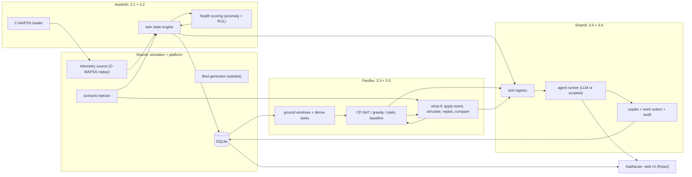
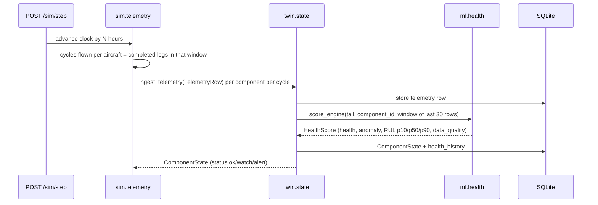
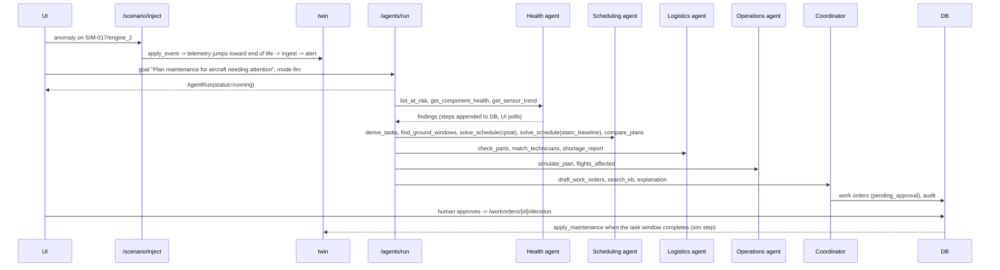

# INTEGRATION: how the six features (3.1 to 3.6) become one running system

Read `CONTRACTS.md` first (models, endpoints, function signatures). This file explains **how the pieces connect, in what order they are
called, and the rules that stop four people's code from colliding.**

## 1. The shape of the system



**One process.** The backend is a single FastAPI app (`uvicorn app.main:app`). Modules are Python packages that call **each other's service
functions directly** (the signatures in `CONTRACTS.md` section 5), not over HTTP. HTTP exists only between the browser and the app.
Why: with ~10 hours, network glue between services costs more than it saves, and in-process calls are trivially testable.

**Single source of truth.** All models live in `app/contracts/models.py`; the database is the shared state; `FleetState` is an
immutable snapshot passed into the pure functions (solver and what-if), so they never touch the database mid-computation.

## 2. Repository layout and ownership

> **Owners changed Sat night (Shamit and Aadhavan swapped jobs). `work/OWNERSHIP.md` is the source of truth for who builds what; where this file names a different owner, follow OWNERSHIP.md. The specs themselves are unchanged.**


```
app/
  main.py  settings.py  db.py                [Shamit]
  contracts/models.py                        [Shamit]  (everyone imports, nobody redefines)
  sim/        fleet.py clock.py telemetry.py scenarios.py            [Shamit]
  ml/         cmapss.py train.py health.py sensors.py artifacts/     [Aashirth]
  twin/       state.py router.py                                    [Aashirth]
  solver/     windows.py tasks.py greedy.py cpsat.py baseline.py router.py   [Pardhu]
  whatif/     events.py simulate.py replan.py compare.py router.py          [Pardhu]
  agents/     tools.py runner.py llm.py prompts.py scripted.py              [Shamit]
  copilot/    chat.py workorders.py kb/*.yaml                              [Shamit]
web/                                                                       [Aadhavan]
fixtures/  scripts/golden.py  scripts/reset_db.py  tests/  Makefile        [Shamit creates; owners add their own]
docs/ (this pack)   data/ (gitignored: db, C-MAPSS files)   .env (gitignored)
```

Rules: **write only inside your own folders.** Need a change in someone else's folder? Message them (or open a small PR). Need a new
shared model field? Edit `CONTRACTS.md`, tell the group, Shamit updates `models.py`.

Each module package exposes: `service` functions (the contract) and optionally a `router` (an `APIRouter`) that `main.py` includes.
Module owners write their own routers for the endpoints marked with their name in `CONTRACTS.md` section 4.

## 3. The three build levels (this is what keeps integration painless)

Every feature has three levels. **Level 1 must exist within 60 minutes** so everyone else can integrate against something real in shape.

| Level | Meaning | Rule |
|---|---|---|
| **L1 stub** | Right function signature and return type, returns fixture-based or heuristic data. Runs with `MOCK=1` | Merge to `main` by **C0 + 45 min** |
| **L2 real** | The real algorithm (trained model, CP-SAT, SimPy, LLM tool loop). Passes its acceptance tests | Target **C1** |
| **L3 polish** | Better numbers, edge cases, UX | Only after all six features reach L2 |

If L2 is not ready at a checkpoint, the **L1 stub stays wired in**; the demo still runs. Nobody blocks on anybody.

`MOCK=1`: every router returns the fixture for its endpoint; services are bypassed. `MOCK=0` (default): real services. A module can also
be mocked individually with `MOCK_ML=1`, `MOCK_SOLVER=1`, `MOCK_AGENTS=1` (each service checks its own flag and falls back to its stub).

## 4. Runtime flows (the "wires")

### 4.1 Telemetry -> health -> twin (features 3.1 + 3.2)



- **Telemetry source.** Engines replay **NASA C-MAPSS trajectories** (each simulated engine is assigned one run-to-failure unit and a
  position along it), so the live features match what the model was trained on and the true RUL is known for evaluation. Brakes, landing
  gear, hydraulics and avionics use small synthetic generators (linear wear with noise, optional step fault). If C-MAPSS cannot be
  downloaded by 21:45, `ml.cmapss.synthetic_trajectories(seed)` generates C-MAPSS-shaped data instead (and the README says so).
- **Window.** The scorer always receives the last 30 rows (or fewer early on, flagged `data_quality: degraded`).
- **Status mapping** (one place, `twin/state.py:status_from()`): `alert` if `is_anomaly` or `rul_p10 < 30` cycles; `watch` if `rul_p10 < 60`
  or `health < 0.5`; else `ok`. `in_maintenance` and `aog` are set only by plan execution and scenario events.

### 4.2 Detect -> plan -> approve (the golden path; features 3.1 to 3.4 and 3.6)



Runtime budget for the live demo: whole workflow **under 40 s** (LLM mode), **under 5 s** (scripted mode). Steps stream to the UI by
polling `GET /agents/runs/{id}` every 1 s.

### 4.3 Disruption -> replan (feature 3.5, the "killer feature")

1. UI (or the copilot) sends `POST /plan/replan` with a `ScenarioEvent`.
2. `whatif.replan` takes `twin.snapshot()`, calls `apply_event_to_state(state, event)` (pure; e.g. DFW kit `eta_hours += 12`,
   `hangar_slots = 0`, technician unavailable, or component RUL shortened).
3. `solver.solve(state', derive_tasks(state'), weights, mode="cpsat", previous=prior)`; the `previous` plan adds a small penalty
   for every changed assignment (stability).
4. Returns `ReplanResult{before, after, diff, solve_seconds}`; the new plan is stored as current, the audit log records `plan_change`, the
   affected work orders go back to `pending_approval`.
5. If infeasible: `after.feasible=false` with `infeasible_reasons`. The UI shows it in red and the Coordinator proposes the least-bad
   option (e.g. "accept a 2.5 h delay on leg L-231") **as a suggestion for a human**, never as an applied relaxation.

### 4.4 What-if lab (feature 3.5)

`POST /whatif/compare` takes named scenarios `{name, events[], constraints?}` and returns one metrics row per scenario, all computed from the
same snapshot. `constraints` (optional) are `{force_station?: str, earliest?: datetime}`. Used for: "maintenance now vs after several more
flights" (`earliest`), "service at another airport" (`force_station`), "part delayed 12 h", "two aircraft need the same technician", "facility
unavailable". Each run is independent, so the UI can fire them in parallel.

### 4.5 Copilot (feature 3.6)

`POST /copilot/chat` -> `copilot.chat()` -> LLM with the **same tool registry** as the agents (read tools plus `solve_schedule`,
`replan_with_event`, `draft_work_orders`) and `search_kb`. The reply is a `ChatResponse` with `answer`, `evidence[]` (tool-call ids / plan ids /
kb docs), `missing_info[]` (what the system could not find) and `proposed_work_orders[]` (always `pending_approval`). The six example questions
in the AeroTwin doc are the acceptance tests (see `FEATURES-3.1-3.6.md`).

## 5. LLM integration rules (agents and copilot)

- Library: the `anthropic` Python SDK; the key comes from the environment variable `ANTHROPIC_API_KEY` (in a gitignored `.env`; **never
  in chat, issues, commits or screenshots**). Model name from `LLM_MODEL` (default `claude-sonnet-5-5`; use a smaller/faster model if latency hurts).
- Pattern: **tool-calling loop**: send `messages` + `tools` (JSON schemas generated from the registry); while the response contains
  `tool_use` blocks, execute each tool in Python, append `tool_result`, call again; stop on a final text answer or `max_steps=8`.
  Check the current SDK docs for exact field names before coding; the `claude-api` skill in Claude Code covers them.
- **Numbers come from tools.** The system prompt says so; the runner then checks that every number in the final text appears in some tool
  output (simple regex over digits); if not, the text is replaced by a template built from the structured data and a warning is logged.
- **Scripted mode.** `agents/scripted.py` runs the same tools in a fixed order and writes the same `AgentStep`s with template text. It is
  the fallback if the key is missing, the API is slow, or conference wifi dies. **The demo must work in scripted mode.**
- **Cache.** In LLM mode, cache `(goal, state_hash) -> AgentRun` to `data/agent_cache.json` so a rehearsed run can be replayed instantly.
- **Safety text** in every system prompt: advisory only; humans approve; never propose maintenance later than a task deadline; if a needed fact
  is missing, say so in `missing_info` instead of guessing; do not invent part numbers, limits or intervals (use `search_kb`).

## 6. Time, determinism and units

- `SimClock` (in `sim/clock.py`) is the only clock. `POST /sim/step` advances it; nothing else calls `datetime.now()` (a lint test greps for it).
- `SEED` (default 1234) drives the fleet, the C-MAPSS unit assignment, the sensor noise and any Monte Carlo in `simulate()`.
- Golden scenario = `reset_db.py --scenario golden` then the inject + replan steps below. Same seed means the same numbers every run, which is
  what lets us put exact numbers on the demo slide.

## 7. Errors and degradation (what each module does when its neighbor fails)

| Failure | Behavior |
|---|---|
| ML model file missing / error | `ml.health` falls back to a rule: health from sensor z-scores, RUL = `None`, `data_quality: degraded` with the reason. Twin keeps working |
| C-MAPSS download failed | Synthetic C-MAPSS-shaped trajectories; README states it |
| CP-SAT infeasible or timeout | Return `Plan(feasible=False, infeasible_reasons=[...])`; Scheduling agent tries `greedy` and reports both |
| CP-SAT too slow (> 5 s) | `time_limit_s` stops it; the best feasible solution found is returned with `objective_value` and a note |
| LLM error / no key | `mode="scripted"` automatically; `AgentRun.mode` records what actually ran |
| Front end gets a 5xx | Shows the error and the last good data; never a blank screen |

## 8. Testing (small, but it runs on every merge)

| Test | Who | Asserts |
|---|---|---|
| `tests/test_contracts.py` | Shamit | every file in `fixtures/` parses into its model |
| `tests/test_ml.py` | Aashirth | RUL MAE/RMSE computed; anomaly precision/recall computed; scorer returns valid `HealthScore` on a fixture window |
| `tests/test_solver.py` | Pardhu | golden state gives a feasible plan; all deadlines met; no technician/hangar/part overlap; infeasible case reports reasons |
| `tests/test_whatif.py` | Pardhu | `part_delay` event changes the plan; diff lists the moved task; a closed facility is respected |
| `tests/test_agents.py` | Shamit | scripted run on golden produces >= 1 pending work order and complete evidence |
| `scripts/golden.py` (`make demo-check`) | Shamit | the full demo path with exact expected structure; prints a pass/fail table; run before every checkpoint |

## 9. Git and merging (four people, one repo)

- Branches: `shamit/<topic>`, `aashirth/<topic>`, `pardhu/<topic>`, `aadhavan/<topic>`; short-lived (< 90 minutes); rebase on `main` before merging.
- Commit prefix by module: `[ml]`, `[twin]`, `[solver]`, `[whatif]`, `[agents]`, `[copilot]`, `[web]`, `[contracts]`, `[sim]`, `[docs]`.
- Shamit is the **only merger to `main`** from C1 onward (fewer conflicts); before C1 everyone may merge their own L1 stubs.
- If you are not a collaborator yet: fork, push to your fork, open a pull request. (Shamit is adding collaborators.)
- Never commit: `.env`, `data/`, any key, the C-MAPSS files (`make data` downloads them), `node_modules`, `__pycache__`.
- Model artifacts (`app/ml/artifacts/*.joblib`, small) **are** committed so nobody has to retrain.
- Run `make demo-check` before merging anything that changes a contract or a service signature.

## 10. Dev setup (everyone, 10 minutes)

```
python -m venv .venv && source .venv/bin/activate         # Python 3.11+ (3.12 fine)
pip install -r requirements.txt     # fastapi uvicorn pydantic scikit-learn xgboost pandas numpy ortools simpy anthropic python-dotenv joblib pytest
cp .env.example .env                 # add ANTHROPIC_API_KEY locally; never commit .env
make reset                           # builds the golden database (< 10 s)
make api                             # uvicorn app.main:app --reload --port 8000     (MOCK=1 make api for fixtures only)
make web                             # cd web && npm install && npm run dev            (http://localhost:5173)
make test                            # pytest -q
make demo-check                      # golden path end to end
```

Ports: API `8000`, web `5173`. CORS allows `http://localhost:5173`.

## 11. Checkpoints (clock times from `SCOPE.md`)

| When | Checkpoint | Verify with |
|---|---|---|
| ~9:15 PM | **C0** contracts + fixtures + mock API running; every owner can run `make api` (MOCK=1) | `curl localhost:8000/fleet` returns 24 aircraft |
| ~10:00 PM | **L1 stubs merged** for ml, twin, solver, whatif, agents, UI shell | `make demo-check` runs end to end on stubs |
| ~12:45 AM | **C1** first real loop: inject -> real model -> real solver -> plan on screen (agents may still be scripted) | `make demo-check` passes with `MOCK=0` |
| ~3:15 AM | **C2 feature freeze**: all six features at L2 or their L1 wired in; no new features | checklist in `TASK-BOARD.md` |
| ~5:45 AM | **C3** submit | demo rehearsed 3x; backup video recorded |

## 12. The integration checklist (tick before declaring "done")

- [ ] `fixtures/*.json` all validate against `models.py`
- [ ] Every endpoint in `CONTRACTS.md` section 4 exists and returns the documented model (`MOCK=0` and `MOCK=1`)
- [ ] The UI works against `MOCK=1` with no backend logic
- [ ] Golden path passes in `scripted` and `llm` modes
- [ ] Disruption replan changes at least one assignment and stays feasible (or reports why not)
- [ ] Baseline vs optimized numbers shown come from `simulate()` on the same snapshot, with the baseline stated
- [ ] Every recommendation has non-empty `evidence`
- [ ] Nothing says "approved" unless a human clicked Approve (audit log has the entry)
- [ ] SIMULATED badge visible; no real tail numbers; no keys in the repo (`git log -p | grep -i key` is empty)

## 13. Plugging your module into the running skeleton (it exists now, built 2026-10-10)

`app/main.py` already serves **every endpoint in `CONTRACTS.md` section 4** from mock data (fixtures + a small in-memory state in `app/api/mockstate.py`), and the web app works against it.
Your job is to replace the mock for your group with the real thing, without changing a single path or model.

**How to switch a group from mock to real**
1. Create `app/<group>/router.py` that defines `router = APIRouter()` with exactly the paths below, using `response_model=` from `app.contracts.models` and request bodies from `app.contracts.requests`.
2. Restart the API and open `http://localhost:8000/health`: `modules.<group>` must say `"real"`. If your module fails to import it says `"mock (import error)"` and `errors.<group>` shows the exception, so a broken module is visible, not silently mocked.
3. Run `make demo-check`. It prints which groups are still mock ("a pass proves the contract, not the module").

| Group | File you create | Endpoints it must serve (all models/requests are already defined) |
|---|---|---|
| `twin` (Aashirth) | `app/twin/router.py` | `GET /aircraft/{tail}` -> `TwinView`; `GET /aircraft/{tail}/telemetry?component=&last=` -> `list[TelemetryRow]` |
| `solver` (Pardhu) | `app/solver/router.py` | `GET /plan` -> `{current, baseline, compare}`; `POST /plan/solve` (`SolveRequest`) -> `Plan` |
| `whatif` (Pardhu) | `app/whatif/router.py` | `POST /plan/replan` (`ReplanRequest`) -> `ReplanResult`; `POST /whatif/compare` (`CompareRequest`) -> `Comparison` |
| `sim` (Aadhavan) | `app/sim/router.py` + `app/sim/fleet.py: generate_fleet(seed)` | `POST /sim/step` (`StepRequest`); `POST /scenario/inject` (`ScenarioEvent`); `POST /scenario/reset` (`ResetRequest`) |
| `agents` (Pardhu) | `app/agents/router.py` | `POST /agents/run` (`AgentRunRequest`) -> `AgentRun` (returns immediately, `status: running`); `GET /agents/runs/{id}` -> `AgentRun` |
| `copilot` (Aashirth) | `app/copilot/router.py` | `POST /copilot/chat` (`ChatRequest`) -> `ChatResponse`; `GET /workorders`; `POST /workorders/{id}/decision` (`DecisionRequest`); `GET /audit` |

Minimal template (copy, rename, fill in):

```python
from fastapi import APIRouter, HTTPException
from app import db                                   # db.put/get/all_, db.kv_get/kv_set, db.sim_now(), db.audit(...)
from app.contracts.models import TwinView

router = APIRouter(tags=["twin"])

@router.get("/aircraft/{tail}", response_model=TwinView)
def get_aircraft(tail: str):
    twin = ...                                       # build a TwinView from the database
    if twin is None:
        raise HTTPException(404, f"unknown tail {tail}")
    return twin
```

**What the skeleton already gives you**
- `app/contracts/models.py` (all models) and `app/contracts/requests.py` (request bodies). Import them; never redefine.
- `app/db.py`: tables from `CONTRACTS.md` section 3, JSON helpers, the key/value table, **`db.sim_now()` (the only clock; never `datetime.now()`)**, `db.audit(actor, action, ref, detail)`.
- `scripts/reset_db.py`: rebuilds the database. If `app.sim.fleet.generate_fleet(seed)` exists it is used; otherwise the DB is seeded from `fixtures/`.
- `fixtures/*.json` (regenerate with `make fixtures`): shape examples for every model, plus the golden scenario. **Numbers in fixtures are made up, not results.**
- `MOCK=1` forces all groups to mock; `MOCK_TWIN=1`, `MOCK_SOLVER=1`, `MOCK_WHATIF=1`, `MOCK_SIM=1`, `MOCK_AGENTS=1`, `MOCK_COPILOT=1` force one group (use this to keep working while a neighbor's module is broken).

**Things that will bite you (read once)**
- **Mixed real/mock.** A mock group keeps its own in-memory state and does not read your database rows. Example: with a real `solver` but a mock `whatif`, `POST /plan/replan` changes the mock plan, not yours. Build `solver` and `whatif` together, or tell the group.
- **`/fleet`, `/legs`, `/stations`, `/metrics`** read the database only when the **real simulator** (`sim`) is running and the DB is seeded; otherwise they follow the mock state, so injected events still show up on the Fleet screen. `/health.data_source` says which.
- `GET /agents/runs/{id}` must return the steps appended **so far** while `status` is `running`; the UI polls it every second.
- Use `response_model=`: the web app's TypeScript types are generated from the OpenAPI schema (`cd web && npm run types`, with the API running). A wrong or missing model breaks the UI types.
- Never print or log `ANTHROPIC_API_KEY`. Stop test servers by PID or port, never with `pkill python`.

